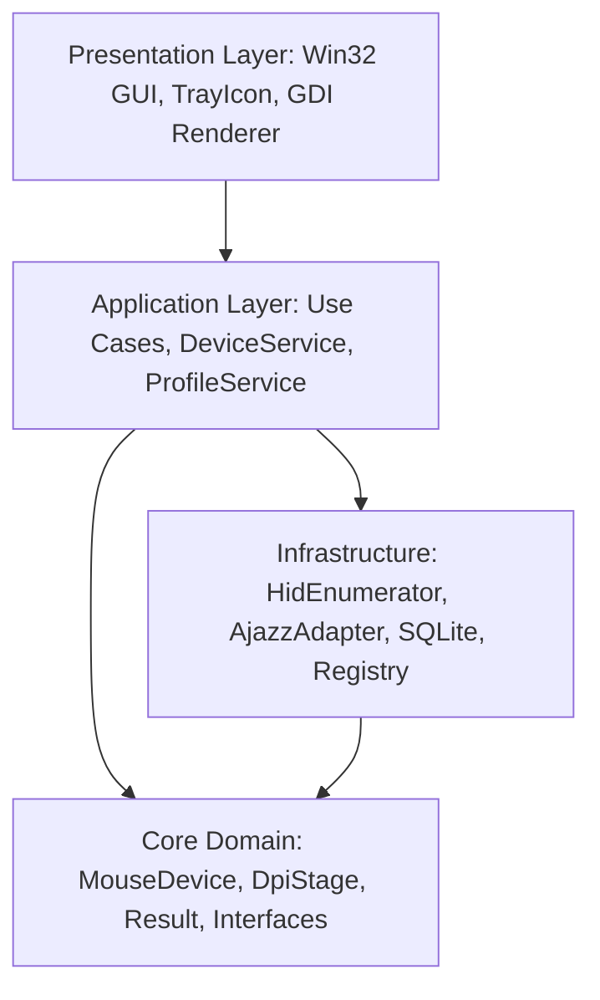

# MouseControl Architecture & Design Specification

## 1. Architectural Philosophy
MouseControl is designed as a high-performance native Windows 11 desktop application written in modern C++20. The primary design goals are:
- **Zero-overhead resource consumption**: Background memory working set $\le 1\text{ MB}$, open UI memory $\le 30\text{ MB}$, and $0.00\%$ idle CPU utilization.
- **Clean Architecture & Onion layering**: Decoupling the device domain and business use cases from Windows-specific HID calls and Win32 UI presentation.
- **Hardware safety**: Strict separation between diagnostic/vendor configuration HID interfaces and standard Windows mouse/keyboard pointer endpoints.

---

## 2. Layered Architecture Overview

### 2.1 Core Domain Layer (`src/core/`)
- Contains pure, dependency-free models: `MouseDevice`, `MouseCapabilities`, `DpiStage`, `MouseProfile`, and `DeviceSettings`.
- Defines domain abstraction interfaces:
  - `IMouseAdapter`: Hardware abstraction for setting DPI, polling rate, and reading battery/version.
  - `IDeviceEnumerator`: Enumerate raw HID devices across USB and Bluetooth.
  - `IDeviceNotifier`: Real-time notification when devices are connected or disconnected.
  - `IProfileRepository` & `ISettingsRepository`: Persistence interfaces.
- Error handling: Monadic `mc::core::Result<T>` pattern for explicit, exception-free return codes.

### 2.2 Application Layer (`src/application/`)
- Encapsulates discrete use cases:
  - `DiscoverDevicesUseCase`: Enumerates HID interfaces and pairs them with supported adapters.
  - `SetDPIUseCase` & `SetPollingRateUseCase`: Validates parameters against mouse hardware capabilities before sending configuration commands.
  - `ManageProfileUseCases`: Profile lifecycle (create, update, switch, delete, import, export).
  - `ManageSettingsUseCases`: Application settings and autostart preferences.
- Coordinators:
  - `DeviceService`: Thread-safe coordinator between physical hardware adapters and UI subscribers.
  - `ProfileService`: Orchestrates profile validation, activation, and JSON serialization.

### 2.3 Infrastructure Layer (`src/infrastructure/`)
- **Windows HID Subsystem (`hid/`):**
  - `WindowsHidEnumerator`: Scans USB and Bluetooth HID collections via `SetupAPI` and Windows HID runtime. Identifies Vendor ID, Product ID, Usage Page, Usage, and device path.
  - `WindowsDeviceNotifier`: Subscribes to `GUID_DEVINTERFACE_HID` through `RegisterDeviceNotificationW` for event-driven `WM_DEVICECHANGE` detection (zero polling).
- **Hardware Adapters (`adapters/`):**
  - `AjazzAdapter`: Custom protocol driver for Ajazz gaming mice (AJ159 series). Operates over Vendor Usage Page `0xFF00` / `0xFFA0`.
  - `GenericAdapter`: Fallback diagnostics driver for non-Ajazz devices.
  - `AdapterRegistry`: Factory matching hardware by VID/PID and assigning the appropriate adapter.
- **Persistence (`database/`):**
  - `SqliteDatabase`: Encapsulates SQLite with WAL (Write-Ahead Logging) mode, 64-bit row IDs, and prepared statement caching.
  - Repositories: `SqliteProfileRepository` and `SqliteSettingsRepository`.
- **System Integration (`windows/`):**
  - `StartupManager`: Standard user-mode autostart via `HKCU\Software\Microsoft\Windows\CurrentVersion\Run`.

### 2.4 Presentation Layer (`src/presentation/`)
- **Pure Win32 GDI Rendering:**
  - Double-buffered memory DC to eliminate all visual flickering.
  - Responsive dark gaming-console palette (`#0D1117`, `#10151D`, `#171E28`, `#BEF264`).
  - Custom-drawn navigation, cards, buttons, checkboxes, and profile rows, with dark edit and trackbar controls.
  - Windows immersive dark title bar and resizable workspace layout.
- **System Tray:**
  - `Shell_NotifyIconW` (version 4) with context menus, active checkmarks, and low-battery toasts.
- **Single-Instance Mutex:**
  - Named Win32 Mutex `Local\MouseControl_SingleInstance_Mutex_v1`. Brings existing instance to foreground on duplicate launch.

---

## 3. Threading & Event Loop

1. **Main UI Thread:**
   - Runs standard Win32 `GetMessageW` message pump.
   - Sleeps when no messages arrive, consuming 0.00% CPU.
2. **Device Event Loop:**
   - Asynchronous device connection events are delivered directly by Windows via `WM_DEVICECHANGE`.
   - Adapters perform non-blocking HID Feature Report transfers.
